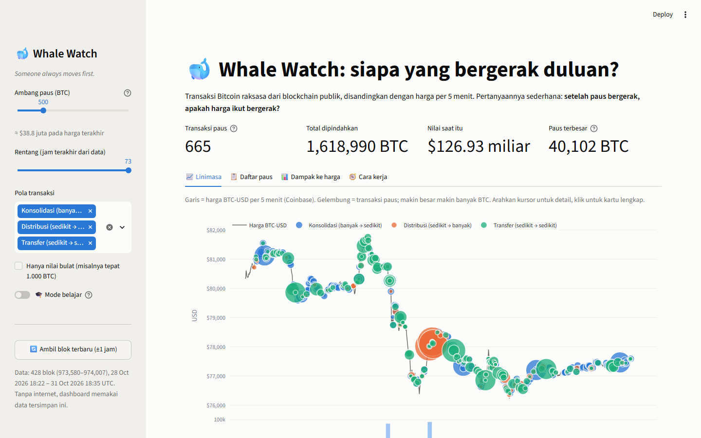
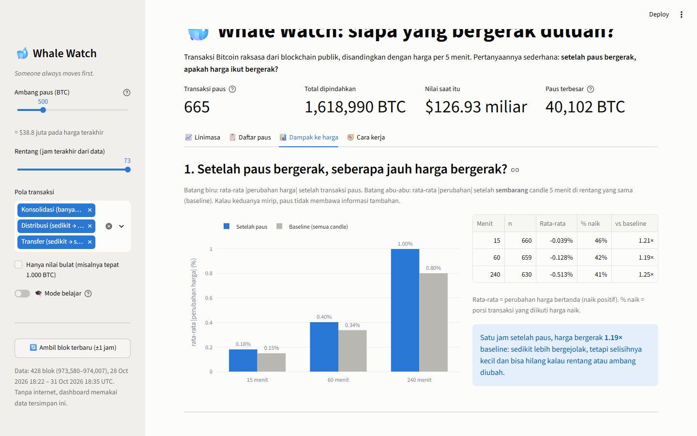
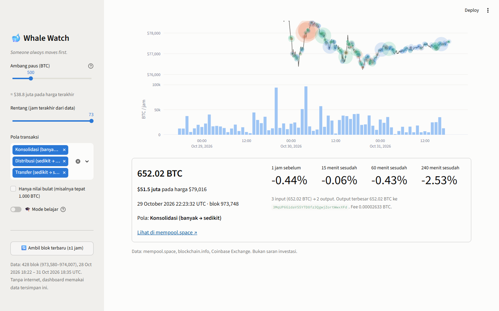
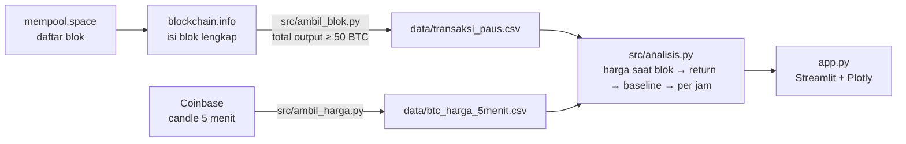

# 🐋 Whale Watch

> **Someone always moves first.**
> Dashboard yang memantau transaksi Bitcoin raksasa langsung dari blockchain publik, lalu bertanya dengan
> jujur: setelah paus bergerak, apakah harga ikut bergerak? Atau justru paus yang mengekor harga?
> Dibangun dengan Python, pandas, Plotly, dan Streamlit.

## 🇬🇧 In English

**Someone always moves first.** A dashboard that catches giant Bitcoin transactions ("whales") straight from the public blockchain, lines them up against 5-minute BTC-USD candles, and asks honestly: when a whale moves, does the price follow, or does the whale follow the price?

- **See** every whale as a bubble on the price timeline, with a link to the block explorer.
- **Measure** price moves 15 minutes, 1 hour, and 4 hours later, against an ordinary-moment baseline.
- **Classify** transaction patterns and test busy hours vs quiet hours with Spearman correlation.
- **Fetch** the latest blocks on demand, or run fully offline on the stored dataset.

**Built with:** Python, pandas, NumPy, Plotly, Streamlit  
**Data:** mempool.space and blockchain.info (on-chain), Coinbase 5-minute BTC-USD candles  
**Engineering:** pytest suite with CI on GitHub Actions, plus a learning mode with the concepts and code

*The rest of this README is in Indonesian.*

**🚀 Coba langsung di browser:** [btc-whale-watch.streamlit.app](https://btc-whale-watch.streamlit.app)



## Kenapa project ini ada?

Setiap hari ada cuitan "paus baru memindahkan 5.000 BTC ke bursa, siap-siap dump". Klaim seperti itu
hampir tidak pernah dicek balik. Project ini mencoba mengeceknya secara sistematis:

1. **Transaksi besar mana saja** yang terjadi dalam beberapa hari terakhir, dan bentuknya seperti apa?
2. **Berapa harga bergerak** 15 menit, 1 jam, dan 4 jam setelah tiap transaksi?
3. Apakah gerakan itu **lebih besar daripada gerakan di waktu-waktu biasa** (baseline)?
4. **Siapa yang bergerak duluan**: gejolak harga sebelum transaksi lebih besar, atau sesudahnya?

Ini pelengkap [btc-news-volatility](https://github.com/Avalon2222/btc-news-volatility): repo itu
mencari penyebab di berita, repo ini mencari penyebab di dalam blockchain sendiri.

## Fitur

| Tab | Isi |
|---|---|
| 📈 Timeline | Harga BTC-USD per 5 menit + gelembung tiap transaksi paus (ukuran = BTC, warna = pola). Hover = ringkasan, klik = kartu detail dengan return sebelum/sesudah dan tautan ke mempool.space. Di bawahnya, BTC yang dipindahkan paus per jam |
| 📋 Whale list | Tabel semua transaksi sesuai filter, bisa diurutkan, tautan ke explorer, download CSV |
| 📊 Price impact | Rata-rata \|Δ harga\| setelah paus vs baseline per horizon, "siapa bergerak duluan", rata-rata return per pola, jam ramai vs jam sepi dengan korelasi Spearman |
| 🧭 How it works | Alur data, definisi, daftar keterbatasan |
| 🎓 Learning mode | Toggle di sidebar: tiap bagian mendapat penjelasan konsep + potongan kode |

Sidebar: ambang paus (50–2.000 BTC), rentang jam, filter pola, filter nilai bulat, dan tombol
**Fetch blok terbaru** yang mengambil ±1 jam blok terakhir dan melengkapi harga. Tanpa internet,
dashboard memakai dataset tersimpan di `data/`.




## Cara menjalankan

```bash
git clone https://github.com/Avalon2222/btc-whale-watch.git
cd btc-whale-watch
python -m venv .venv && source .venv/bin/activate   # Windows: .venv\Scripts\activate
pip install -r requirements.txt
streamlit run app.py
```

Buka `http://localhost:8501`. Jalankan tes dengan `python -m pytest tests/ -v`. Tes yang sama otomatis jalan di GitHub Actions setiap push dan pull request.

Memperbarui data (butuh internet, tanpa API key):

```bash
python -m src.ambil_blok --jam 24    # unduh blok 24 jam terakhir yang belum ada (±2-5 detik per blok)
python -m src.ambil_harga            # lengkapi candle 5 menit sampai menutupi semua blok
```

## Cara kerja (ringkas)



Inti analisisnya:

```python
harga_saat = merge_asof(paus, harga, on="waktu", direction="backward")      # candle terakhir ≤ waktu blok
r_60m      = harga_pada(waktu + 60 menit) / harga_saat - 1                  # return 1 jam setelah paus
baseline   = harga["close"].shift(-12) / harga["close"] - 1                 # return 1 jam dari SETIAP candle
rasio      = r_60m.abs().mean() / baseline.abs().mean()                     # ≈ 1 berarti paus bukan sinyal
```

Kenapa harus ada baseline? Karena "harga bergerak 0,1% setelah paus" tidak berarti apa-apa kalau harga
memang bergerak 0,1% setiap jam. Penjelasan lengkap di [docs/BELAJAR.md](docs/BELAJAR.md).

## Temuan dari dataset tersimpan

Snapshot: 428 blok, 28–31 Oktober 2026 (72 jam), ambang default 500 BTC, harga turun sekitar 3,6% sepanjang
rentang itu.

- Ada **665 transaksi ≥ 500 BTC** dalam tiga hari (dan 4.570 kalau ambangnya 100 BTC, hampir 11 per blok).
  Totalnya 1,6 juta BTC "berpindah", tetapi angka itu menghitung koin yang sama berkali-kali: transaksi
  terbesar (**40.102 BTC, sekitar $3,1 miliar**) disusul 39.852 BTC dan 39.597 BTC dalam 45 menit
  berikutnya. Itu satu tumpukan yang sama yang membayar ±250 BTC tiap kali dan mengirim sisanya ke alamat
  baru, bukan tiga paus berbeda.
- **Harga satu jam setelah paus bergerak 0,40%, baseline 0,34%: rasio 1,19×.** Di 15 menit dan 4 jam rasionya
  1,21× dan 1,25×. Ada sedikit gejolak ekstra, tetapi jauh dari "paus bergerak, pasar guncang". Di ambang
  100 BTC rasionya turun ke sekitar 1,1×.
- **Siapa yang bergerak duluan?** Gejolak satu jam *sebelum* transaksi (0,44%) sedikit lebih besar daripada
  *sesudahnya* (0,40%). Kalau ada hubungan, arahnya lebih mirip paus bereaksi pada harga, bukan sebaliknya.
- Ketiga pola (konsolidasi, distribusi, transfer) sama-sama diikuti harga yang sedikit turun; hanya 40–43%
  kejadian diikuti kenaikan, persis seperti pasar secara umum di minggu yang sedang turun. Narasi "koin keluar
  bursa = bullish" tidak terlihat di data ini.
- **72 dari 73 jam** punya setidaknya satu transaksi ≥ 500 BTC. "Paus bergerak" bukan peristiwa langka; itu
  kondisi normal jaringan. Korelasi Spearman BTC paus per jam vs gejolak jam berikutnya: +0,15 (lemah).
- Hanya 5% transaksi memakai nilai bulat, dan porsinya tidak naik di ambang lebih tinggi (4% pada
  ≥ 1.000 BTC). Transfer tepat 1.000 BTC memang biasanya urusan internal kustodian, tetapi kustodian besar
  jelas tidak selalu memakai angka bulat. Filter "hanya nilai bulat" di sidebar ada untuk mengecek dugaan
  seperti ini, bukan untuk mempercayainya.

Angka di atas berubah kalau slider digeser atau data diperbarui, dan memang itu tujuannya.

## Struktur folder

```
btc-whale-watch/
├── app.py                     # dashboard Streamlit (tampilan)
├── src/
│   ├── ambil_blok.py          # mempool.space + blockchain.info → transaksi paus
│   ├── ambil_harga.py         # Coinbase → candle 5 menit
│   ├── muat_data.py           # baca + validasi CSV
│   └── analisis.py            # harga saat blok, return, baseline, per jam, Spearman
├── data/
│   ├── transaksi_paus.csv     # transaksi ≥ 50 BTC
│   ├── blok.csv               # ringkasan blok yang sudah diproses
│   ├── btc_harga_5menit.csv
│   └── SUMBER_DATA.md
├── tests/                     # pytest, tanpa internet
└── docs/
    ├── BELAJAR.md             # panduan 10 langkah
    ├── LATIHAN.md             # 9 latihan bertingkat
    └── screenshots/
```

## Keterbatasan

- **Korelasi bukan sebab-akibat.** Paus dan harga bisa sama-sama bereaksi pada berita yang sama.
- **Tidak ada label alamat.** Dashboard tidak tahu alamat mana milik bursa; pola konsolidasi/distribusi
  hanya tebakan dari bentuk transaksi. Satu transaksi besar sering kali bursa merapikan saldo internal.
- **Waktu transaksi = waktu blok.** Transaksi sudah terlihat di mempool beberapa menit sebelumnya.
- **Rentang data pendek.** Beberapa hari saja; minggu lain bisa bercerita lain. Latihan 9 di
  LATIHAN.md membahas versi waktu nyata.
- **Bukan saran investasi.** Ini alat belajar untuk menguji narasi dengan data.

## Lisensi

MIT. Data blockchain bersifat publik; harga milik Coinbase Exchange.
